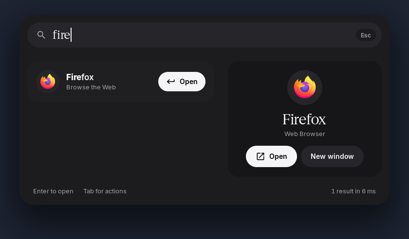
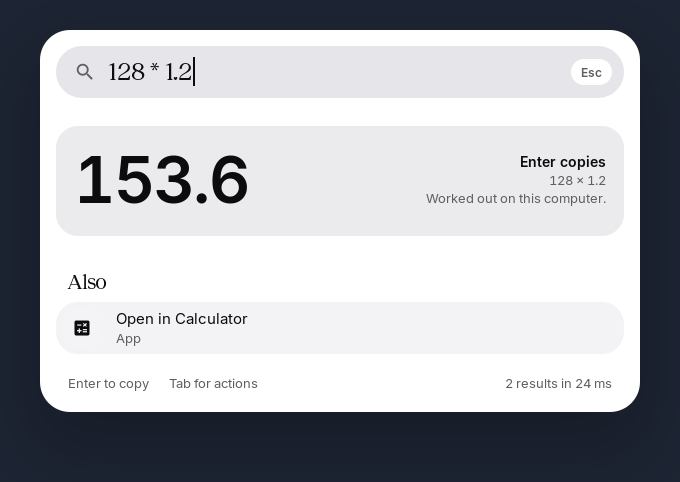
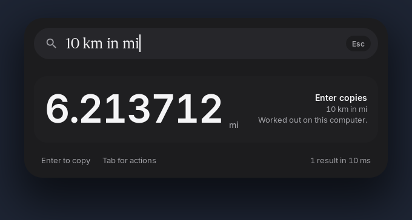
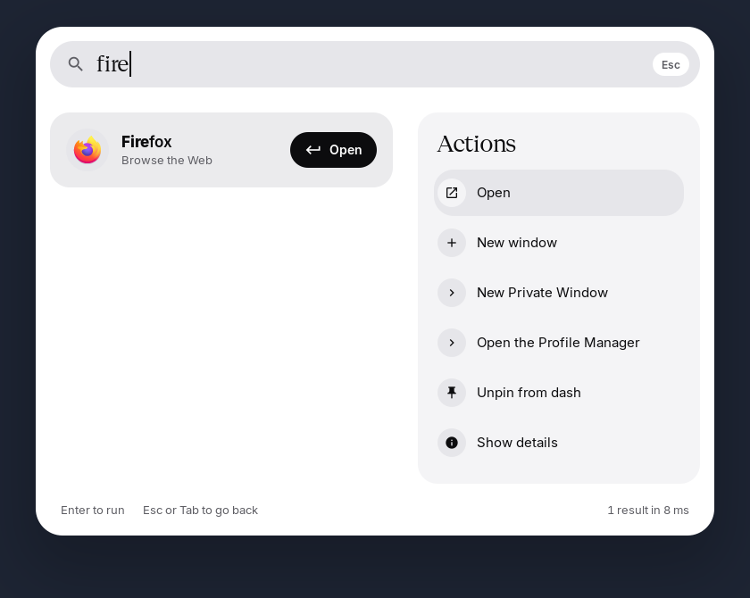
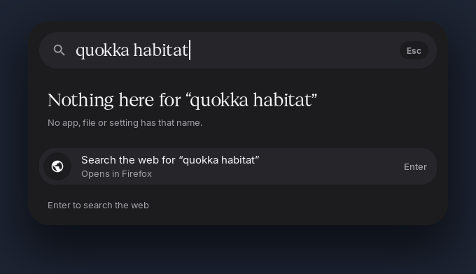
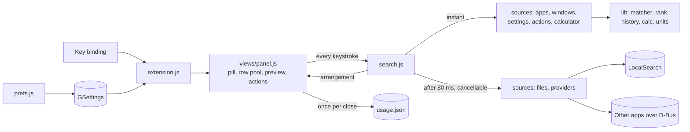

<div align="center">
  <h1>Lantern</h1>
  <p><strong>A launcher for GNOME Shell in the manner of Spotlight: one shortcut, one field, and the right app, window, file, setting or answer under the cursor before the hand leaves the keyboard.</strong></p>

  <p>
    
    
    
    
    
    
    
    
  </p>
</div>

---



**Lantern** (the extension's name inside GNOME is **Material Search**) opens a floating pill in the upper third of the main screen. Typing grows it into a panel: one flat **top hit** with the one black button, results in **list groups** below it, and a **preview** of the selected result beside them. **Enter** opens, **Tab** shows what else can be done with it, **Esc** closes.

It is built around three rules, in this order: **fast** (the in-memory sources answer within the keystroke), **free at rest** (while closed it runs nothing), and **frugal when used** (only what is on screen is worked out; a new keystroke cancels what is no longer wanted).

---

## Features

- **One Shortcut:** **Super+Space** by default. GNOME uses it to switch input sources, so on the first enable the launcher takes **Ctrl+Space** and asks once whether to take Super+Space instead; **Shift+Super+Space** keeps switching input sources. The settings give it back with one button.
- **The Pill First:** Opening shows only the search field. Nothing is asked of any source until the first character.
- **Apps:** By name, generic name, keywords and program name. **Enter** raises the app's last window when it has one, as the dash does; **New window** starts another.
- **Open Windows:** By title and app, with the workspace they are on.
- **GNOME Settings:** The panels of Settings, by name and keywords.
- **Calculator and Units:** `128 * 1.2`, `200 + 10%`, `sqrt 2`, `5!`, `10 km in mi`, `100 f to c`, `1 GiB in MB`. Worked out by a parser of its own (no `eval`), shown as a large number. **Enter** or **Ctrl+C** copies it.
- **System Actions:** Lock, log out, suspend, switch user, restart, power off, screenshot, by name or keyword (**shutdown** finds Power Off). Log out, restart and power off ask in **GNOME's own dialog**.
- **Files by Name:** From **LocalSearch**, after two letters and **80 ms** without a key; every keystroke cancels the last question.
- **Inside Documents:** Only on request, with **Search in Files** when nothing matches by name.
- **Other Apps' Searches:** GNOME's search providers (Calculator, Characters, Contacts, Software and others), each switched on separately, none by default. One that takes longer than **300 ms** is left out.
- **The Web:** When nothing matches, **Search the web** hands the text to the default browser. Google by default; DuckDuckGo, Startpage, Ecosia, Bing or an address of your own.
- **Actions Behind Tab:** Open, new window, the app's own actions, pin to the dash, quit; for files open with, show in folder, copy path, move to trash; for windows switch, move here, minimise, close.
- **Ranking by Use:** What you open for what you typed comes first next time. Counts lose half their weight every two weeks.
- **Insights Mono:** One look, black and white with air, light and dark after the system's setting. Statements (the empty field's invitation, the query, group headings, the name in the preview, "Actions", "Nothing here") are in **Geist Serif**, everything else in **Inter** with tabular figures. No colour styles, no blur.
- **See-Through:** The panel's outer surface at 78 % lets the windows show through; field, rows and preview stay solid. No blur. Off by default.
- **Ask Claude, agy or a local model:** `claude: question`, `agy: question` or `ollama: question` turns the prefix into a chip and sends the text to that command line program on **Enter**. The answer streams into a card in the panel, code on its own box; more text and **Enter** is a follow-up in the same conversation. **Esc** stops a running answer, then leaves the mode and the conversation (a second **Esc** closes the panel). Claude runs without tools, text only. `ollama:` asks the model set in the settings (default `qwen2.5:3b`) on the local Ollama server; the model loads while you type the prefix, and follow-ups send the conversation so far. **Settings → Ask** switches all of it off; then the prefixes are searched like any other text and nothing is started. One process per question, nothing runs in between. Each question uses the program's own account and quota, and **Claude takes about 10 s per answer on the laptop** (the same from a terminal).
- **Compact on Small Screens:** Without the preview column below **1400** logical pixels, or always, or never.
- **English and German.**

| Light | Dark |
| :--- | :--- |
|  |  |
|  |  |

---

## Keys

| Key | Does |
| :--- | :--- |
| **Super+Space** (or **Ctrl+Space**) | Opens and closes |
| **Up**, **Down**, **Page Up**, **Page Down**, **Ctrl+P**, **Ctrl+N** | Move the selection |
| **Enter** | Opens the selected result; copies an answer |
| **Ctrl+Enter** | Shows a file in its folder |
| **Tab** | The actions of the selected result; **Tab**, **Esc** or **Left** go back |
| **Ctrl+C** | Copies the answer, unless text in the field is selected |
| **Esc**, a click outside | Closes |

---

## Sources

The sources are asked cheapest first. The instant ones answer within the keystroke from lists prepared once; the slow ones are asked after a pause and their results are added **below** what is shown, so the top hit and the selected row never move.

| Source | Cost | Read from | Kept while closed |
| :--- | :--- | :--- | :--- |
| **Apps** | instant | `Shell.AppSystem` | The prepared names; installing an app marks them stale |
| **Windows** | instant | The window list, at the first keystroke | Nothing |
| **Settings** | instant | The `.desktop` files of GNOME Settings' panels | The prepared names |
| **System actions** | instant | The shell's own system actions | Nothing |
| **Calculator and units** | instant | `extension/lib/calc.js`, `extension/lib/units.js` | Nothing |
| **Files by name** | slow | `org.freedesktop.LocalSearch3`, full-text index of names | The connection, after the first file search |
| **Inside documents** | on request | The same, full-text index of contents | Nothing |
| **Search providers** | slow, opt-in | `org.gnome.Shell.SearchProvider2` | Nothing |
| **The web** | on request | The default browser | Nothing |

The name query asks LocalSearch for no order and no join across graphs: on a laptop with **163 000** indexed files that keeps it at **1 to 3 ms**, where ordering by date or asking which results are folders took **100 to 600 ms**. Results are ranked here instead.

---

## Cost

*Tested* in a headless GNOME Shell 50.6 on the laptop (**i5-8350U**, integrated graphics, 1600x1000), with `tools/headless/run.sh cost` and `memory`, on a machine that was busy with other work (load average about 5), so read the times as upper bounds. Not measured on a real screen yet, and not with `powertop`.

| Measure | Target | Measured |
| :--- | :--- | :--- |
| Key to first painted frame | under 50 ms | **9 ms** median, **22 ms** the first time |
| Work per keystroke (instant sources) | under 8 ms | **2.7 ms** median, **13 ms** for the very first keystroke |
| Last keystroke to first file results | under 150 ms | **about 112 ms**, of which 80 ms is the deliberate pause |
| CPU while closed, 30 s | as without the extension | **0.2 to 0.6 %** of one core, the same as without it (**0.7 %** on the same run) |
| Memory | under 15 MB | **+10 MB** at rest against the shell without the extension |

While closed the panel is hidden (out of the paint, not at opacity 0), and there is no timer, timeline or poll. What waits is the key binding and a few change signals (an app installed, the settings); a signal only marks a list as stale. A stale list is rebuilt in the idle moment right after the panel's first frame. The battery state is asked once per opening, never watched.

On battery the panel appears without motion (switchable), and the preview decodes no thumbnail. Thumbnails come only from GNOME's existing cache; none is made here.

---

## Architecture



- **`extension/lib/`:** Pure logic without shell imports, unit tested: matching with highlighted letters, ranking into one top hit and groups, the use counts, the calculator, units, shortcut comparison and small formats.
- **`extension/sources/`:** One module per source with `search(terms, query, now, cancellable)` and a cost class.
- **`extension/views/`:** The panel in St. A fixed pool of rows (8 groups of 6) is built once at enable; a keystroke sets text, icons and visibility and creates no actor. Badges are circles from the stylesheet, so nothing is drawn in code and a scheme change costs nothing.
- **`tools/`:** The token build (`build-tokens.js` and `stylesheet.template.css`), and the headless GNOME Shell rig in `tools/headless/`.

The tokens and fonts are those of the **Insights Mono** design system (`insights-mono/`).

---

## Files on Disk

| Path | Holds |
| :--- | :--- |
| **~/.local/share/material-search/usage.json** | What was opened for what was typed; at most 400 entries |
| **GSettings** `org.gnome.shell.extensions.material-search` | The settings |

Nothing leaves the computer, except the text of a web search, and only when you choose it.

---

## Install

```bash
git clone https://github.com/tomsliikee/lantern.git
cd lantern
./install.sh
```

`install.sh` builds the settings schema and the translations, links the extension into `~/.local/share/gnome-shell/extensions`, installs **Inter** and **Geist Serif** if they are missing and enables the extension. Log out and back in to load it. The settings are in the **Extensions** app.

Needs **GNOME Shell 50**, `gjs`, `glib-compile-schemas` and, for German, `msgfmt`. File search needs **LocalSearch**, which GNOME ships.

---

## Development

```bash
for t in tests/*.test.js; do gjs -m "$t"; done
```

```bash
node tools/build-tokens.js
```

```bash
tools/headless/run.sh keys 60
```

- **Unit tests:** `tests/*.test.js`, 54 tests for matcher, ranking, history, calculator, units and formats, without a test dependency.
- **Headless rig:** `tools/headless/run.sh <script> [seconds]` starts a GNOME Shell without a screen with its own settings and runs a script from `tools/headless/scripts/`: `keys` (keyboard, pointer, motion, 33 checks), `gallery` (every state, wide and compact; `MS_SCHEME=default` for light), `sources` (providers, inside documents), `prefs` (the settings window), `cost`, `memory` (with `MS_WITHOUT=1`), `german` (with `LANG=de_AT.UTF-8`), `seethrough` (over a window), `readme`.
- **Translations:** `po/material-search.pot` is made with `xgettext`; `tools/build.sh` compiles `po/*.po`.
- **Design:** `material-search.html` is the design example; open it in a browser from this folder; it loads the fonts from `insights-mono/fonts/`.

---

## Status

| Part | State |
| :--- | :--- |
| Panel, keys, pointer, all sources, actions, ranking, compact mode, German | *Tested* in the headless shell on the laptop |
| Settings window | *Tested* in the headless shell: opened, a switch clicked and taken over by the panel, pages shown |
| Opening an app, a file, a window, a system action for real | *Built*: the code paths ran, nothing was opened on a real desktop |
| The first-enable question about Super+Space | *Tested* that Ctrl+Space is taken and works; the notification's buttons were not clicked |
| Ask mode with `claude:` | *Tested* in the headless shell: chip, streaming, code block, follow-up, Esc, once against the real `claude` and with a stand-in program. Unit tests for the prefix, command lines and both stream formats |
| Ask mode with `ollama:` and the AI switch | *Tested* in the headless shell against the local Ollama (`qwen2.5:3b`): streaming, a follow-up that knew the earlier answer, and the switch off (the prefix is searched as text). On this CPU about 10 tokens/s, the 7b model about 4. The Ask settings page was opened; the model field was not edited |
| Ask mode with `agy:` | *Built*: the stream format and a follow-up were tested from a terminal; in the headless shell the program was not signed in (it opened a browser sign-in), so no answer was seen in the panel |
| The real session (install.sh, a real screen, motion seen, `powertop`) | Not yet |

A search provider that is not running is started by its first question, which usually takes longer than 300 ms; its results then come from the second question on.

---

## License

**MIT**, see `LICENSE`. **Inter** and **Geist Serif** are under the **SIL Open Font License** (`insights-mono/fonts/OFL-Inter.txt`, `OFL-Geist.txt`). The icons in `extension/icons/` are **Material Symbols** (Apache License 2.0).
